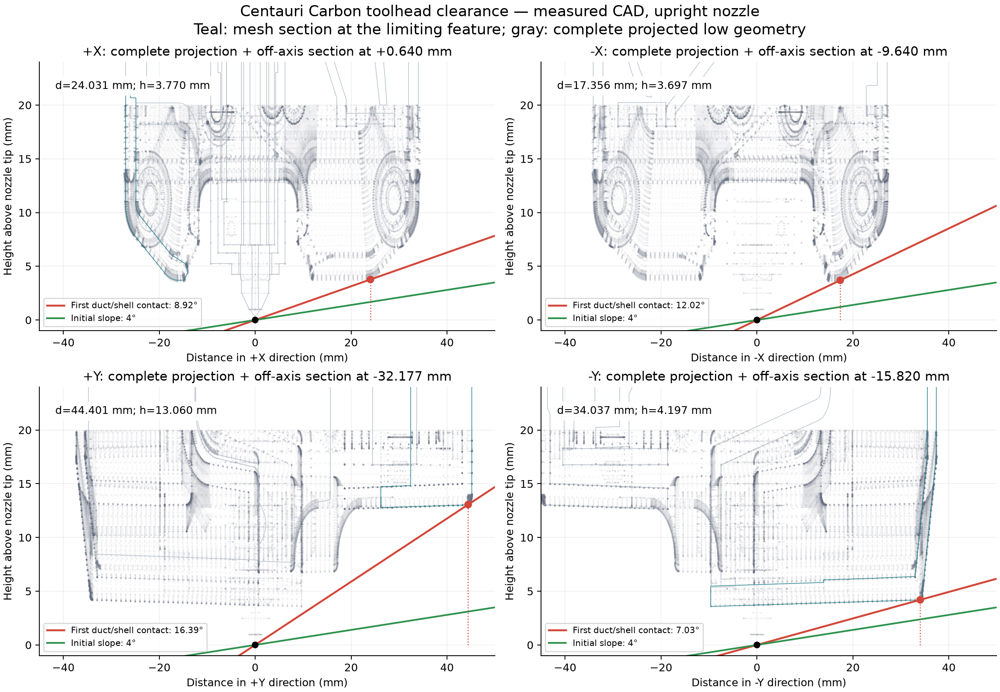
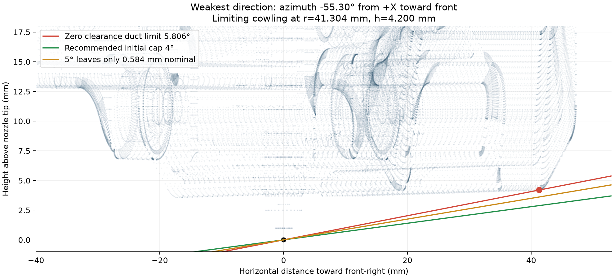
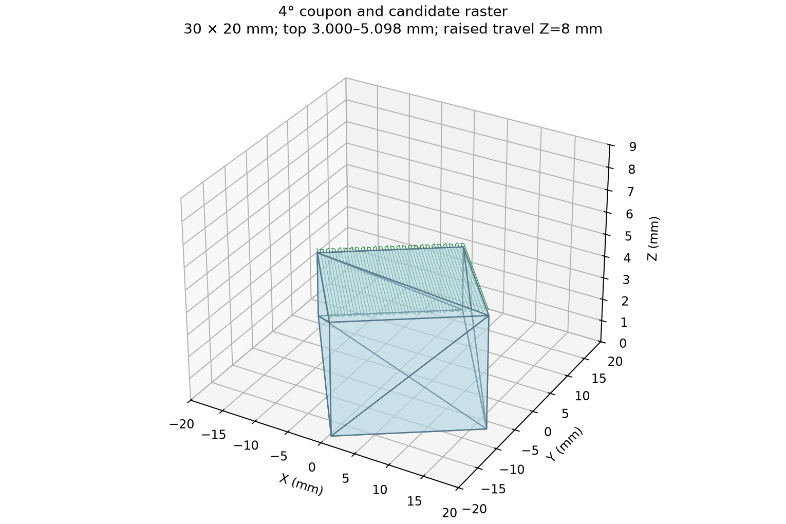

# Centauri Carbon nonplanar geometry measurement report

> Historical initial audit: its conservative recommendation is 4 degrees. The published user-requested 5 degree trial presets and later 0.2 mm addition are documented in [README.md](README.md). Neither configuration has been physically validated.

**Date:** 10 October 2026. **Result:** provisional CAD settings with a 0.5 mm nominal clearance target. **Recommended initial layer inclination: 4°.** This report establishes a geometrical screen for the inspected assembly; physical printing, thermal changes, firmware behavior and actual exported slicer paths remain unvalidated.

## Evidence and source identity

The live Fusion document is **CC**, an imported Centauri assembly, version **1**. It already had unsaved changes at the start. Geometry and joint positions were inspected without editing or saving them; camera views were temporarily changed and restored.

The assembly inventory contains **2160 occurrences**. The XY assembly extraction contains **650 BRep bodies**, including **252 toolhead bodies**. The refined extraction contains **1,471,211 triangles**, of which **808,425 belong to the toolhead**. All toolhead bodies were included regardless of display visibility, including fasteners, connectors, fan internals, housing, extruder and motor.

The referenced [OpenCentauri CAD repository](https://github.com/OpenCentauri/cad) was checked; its current commit was `c63a80d3026bf582296c6372a716c6e80fd5bbae`. The live F3Z import cannot be tied to that Git commit from its file description. The report therefore measures the live assembly rather than claiming it is an exact copy of the latest repository STEP. OpenCentauri credits a mixture of official plastic-part models and community integration/revisions.

The installed executable reports **Unlayered Slicer 0.1.2**, and the saved application selection is **Elegoo Centauri Carbon 0.4 nozzle**. Its stock profile lists a 256 × 256 mm bed and a 256 mm height. The [Unlayered source](https://github.com/Unlayered3D/Unlayered-Slicer/tree/v0.1.2) was checked, including `PrintConfig.cpp`, `PrintConfig.hpp`, `GCode.cpp` and `GCode/HotendCollisionCheck.cpp`. The setting definitions downloaded from `v0.1.2` and current `main` have identical SHA-256 hashes. No installed preset was changed during this initial read-only audit. The later 5 degree user presets are documented in README.md.

## Coordinates and numerical method

The center of the terminal nozzle face is the reference origin. Its Fusion world coordinates are **(−160.120, 161.350, 289.025) mm**. For this assembly the coordinate transform is a translation:

`X = CAD_X + 160.120; Y = CAD_Y − 161.350; Z = CAD_Z − 289.025`, in millimeters.

Positive X is toward the modeled right-side idler/motor mounts; positive Y is toward the rear motors/exhaust and away from the front cowling, screen and door; positive Z is upward, away from the build plate. The X rods run along X, the Y rods along Y, and the nozzle axis is vertical. This verifies the model's orientation from assembly features. A real-machine axis/jog check is still required before treating slicer direction labels as physically verified.

Fusion internal centimeters were converted to millimeters explicitly. Exported proxy meshes were compared with world-coordinate BRep bounding boxes: no mesh vertex exceeded its body bounding box by more than **0.000016 mm**, allowing numerical roundoff. Bounding boxes sometimes overestimate the occupied surface, so their vacant corners were not used as collision points.

All XY bodies were triangulated with a requested surface deviation of **0.020 mm** and maximum triangle edge of **2 mm**. Four low cowling/insert bodies were refined to **0.002 mm** deviation and **1 mm** maximum edge. Reported contact dimensions are computed surface coordinates, rounded to 0.001 mm for reproducibility; they are not claims of micrometer accuracy on the physical printer. Treat the refined angular values as approximately **±0.05° numerically** and physical error as **unknown until measured**. The tolerance request is numerical evidence, not an independently certified global CAD error bound.

For an uphill direction unit vector u, each surface point q=(x,y,h) has directional horizontal reach `d=u·(x,y)`. For d>0, first contact with a plane through the nozzle datum is `θ=atan2(h,d)`. The minimum is evaluated over the complete head surface, preserving the perpendicular/off-axis coordinate. Linear plane clearance is exact over each exported triangle when checked at its vertices. Curved BRep surfaces are approximated by the meshes.

For a required normal air gap c, the tighter criterion is:

`h cos θ − d sin θ ≥ c`

and its limiting angle at a point is `atan2(h,d) − asin(c/sqrt(h²+d²))`. The minimum is recomputed after applying the margin, because a different point can become limiting. A 0.5 mm margin is a CAD clearance target, not a measured uncertainty or guarantee that the real hardware has 0.5 mm air gap.

## Completeness and component positions

| Collision component | Evidence in live assembly | Position/lowest height above nozzle | Qualification / physical check |
|---|---|---:|---|
| Nozzle and tip | `cc hotend:1/Component3:1`, brass appearance, 20 BRep faces | 0 mm | Bore is 0.4 mm; terminal outer flat diameter is 0.5 mm. Actual nozzle length, tip profile and seating require measurement. |
| Sock-like hotend cover | `cc hotend:1/Component4:1`, black appearance | 4.250 mm | Cover geometry is present. Its material metadata incorrectly says steel, so silicone material/fit/compliance cannot be inferred from CAD. |
| Heater/block assembly | `Component5:1` has a 10.5 × 8 × 28.5 mm bounding extent; adjacent `Component6:1` is a thin 1 × 8 × 17.5 mm plate | 7.000 mm / 11.250 mm | Consistent with heater/block and plate-heater representations. Component names and materials are generic/inconsistent; sensor leads and the glass-bead thermistor envelope are not independently identified. |
| Heat sink | `cc hotend:1/Component1:1`, aluminum appearance | 27.500 mm | Present and above the nozzle/sock. Modeled placement is internally consistent, not a physical seating measurement. |
| Hotend fan and guide | `3010 Axial Fan v1:1` and the adjacent heat-sink air guide | 18.050 mm / about 18.022 mm | Present on the right of the hotend; matches the 3010 fan architecture described by OpenCentauri. Wiring and fan tolerances are not complete envelopes. |
| Part fan and duct | `cowling/front cowling/5020FanCC:1`, 3 bodies, plus magnetic front shell and `FrontInsert:1` | Fan housing 25.537 mm; front shell 3.581 mm; insert 4.979 mm | Present. The low shell/duct ends are the main slope blockers. Fan housing placement is consistent with the front blower. Shell revision, magnet seating, duct deformation and screw seating require comparison with the machine. |
| Middle/rear shrouds | `cowling/挤出头外壳.` and `cowling/挤出头后壳` | about 6.751 mm / 12.672 mm | Present; rear outer corner limits +Y. Stock-looking CAD alone does not establish that every production revision has this envelope. |
| Bed probing | Four bed-assembly strain-gauge bodies and bed electronics are present | Below the bed, away from the tip envelope | No separate descending probe pin was identified on the head. This is consistent with nozzle-contact/bed-pressure leveling; [OpenCentauri bed documentation](https://docs.opencentauri.cc/hardware/CC1/bed/) identifies bed pressure sensors. Verify actual installed hardware and any modifications. |
| Carriage, PCB, motor and fasteners | All included in the full extraction | Carriage underside 16.750 mm; low carriage/PCB fastener 15.123 mm | These affect taller nearby geometry and travel. Fasteners were not discarded merely because they are small. |
| Cable, USB connector, cable chain and PTFE | USB connector/cable bodies on the head; larger chain/tube elsewhere in assembly | Most lie well above the lowest duct | These are single modeled poses. Free wire loops, slack, cable routing and the chain/tube sweep over XY travel are not established. |

The sock and nozzle are concentrically positioned; the 3010 fan is beside the heat sink and the 5020 blower is in the front shell. There was no displaced low component identified from the numerical envelope and views. These are **model consistency checks**, not proof of correct real assembly dimensions. The model's generic hotend names and inconsistent material assignments are explicit approximation flags. OpenCentauri's [toolhead documentation](https://docs.opencentauri.cc/hardware/CC1/toolhead/) supports the 5020/3010 fan architecture and ceramic plate heater but does not validate these CAD dimensions.

## Directional collision limits

The table concerns the **non-contact toolhead envelope**. It excludes the terminal nozzle contact band, discussed separately below. A direction names the way the printed surface rises, rather than the way a surface normal tilts.

| Uphill direction | Limiting component | Contact coordinate (x,y,z), mm | h, mm | d, mm | Nominal first-contact angle | Limit with 0.5 mm normal gap |
|---|---|---|---:|---:|---:|---:|
| Right / +X | Front magnetic cowling / part-cooling duct | (+24.031, +0.640, 3.770) | 3.770 | 24.031 | 8.917° | 7.739° |
| Left / −X | Front magnetic cowling / part-cooling duct | (-17.356, +9.640, 3.697) | 3.697 | 17.356 | 12.024° | 10.410° |
| Back / +Y | Rear cowling lower outer corner | (+32.177, +44.401, 13.060) | 13.060 | 44.401 | 16.391° | 15.772° |
| Front / −Y | Front magnetic cowling / part-cooling duct | (-15.820, -34.037, 4.197) | 4.197 | 34.037 | 7.029° | 6.194° |

These coordinates include substantial off-axis offsets: the −X contact lies at Y=+9.640 mm, the +Y contact lies at X=+32.177 mm, and the −Y contact lies at X=−15.820 mm. A central section would miss them.

| Diagonal uphill direction | h, mm | projected d, mm | Nominal limit | With 0.5 mm normal gap |
|---|---:|---:|---:|---:|
| +X+Y | 3.770 | 17.445 | 12.196° | 10.591° |
| -X+Y | 3.646 | 18.889 | 10.925° | 9.428° |
| -X-Y | 4.204 | 35.754 | 6.706° | 5.911° |
| +X-Y | 4.200 | 40.638 | 5.900° | 5.199° |

The worst azimuth over the entire head is **-55.301° from +X toward −Y (front-right)**, not exactly a 45° diagonal. Its front cowling contact is **(23.513, -33.958, 4.200) mm**, at radial reach **41.304 mm**. The nominal limit is **5.806°**; the 0.5 mm normal-gap limit is **5.116°**. These are conditional on a surface/nearby printed geometry remaining below the evaluated plane or equivalent slope bound.

The figure combines the complete low-head projection with mesh sections through the limiting off-axis positions. They are CAD-derived mesh sections; native Fusion plane-intersection calls returned `InternalValidationError`, so these figures do not claim a completed native Fusion interference test. Separate actual Fusion viewport captures are supplied, including `fusion_toolhead_underside.png`.

## Nozzle contact is a separate limit

The modeled nozzle has a finite terminal annulus: outer radius 0.25 mm and bore radius 0.20 mm. A rigid inclined plane passing through the center of the flat terminal face immediately enters its uphill rim. Thus the literal zero-gap, full-solid/nozzle-tip contact limit is **0° in every direction**. The positive duct/shroud angles above are clearance angles outside that intended extrusion-contact region; they do not turn the fixed nozzle into a rotating tool.

A hypothetical nozzle 0.20 mm vertically above an already-solid parallel surface has approximately **0.182 mm** minimum normal gap at 4° when the finite rim is included. This is adequate in that particular rigid-substrate geometry, but the fresh bead normally interacts with the tip. Nozzle dragging, melt deformation, extrusion width, squish, layer quality and Z offsets cannot be certified by this CAD calculation. A larger/replacement/worn tip changes that analysis.

## Margin sensitivity and initial angle

| Required nominal normal gap, mm | Weakest non-contact envelope angle |
|---:|---:|
| 0.00 | 5.806° |
| 0.10 | 5.668° |
| 0.25 | 5.461° |
| 0.50 | 5.116° |
| 1.00 | 4.425° |
| 1.50 | 3.733° |

Reducing 0.50 mm to 0.25 mm gains only **0.345°** at the limiting duct. Keep **0.5 mm** as the initial CAD target. A 0.25 mm follow-up target is reasonable only after physical measurements and a controlled coupon confirm the installed geometry and motion. No evidence in this study justifies a sub-0.25 mm practical clearance.

The recommended **4°** cap has approximately **1.307 mm nominal non-contact clearance** in the worst azimuth, leaving **0.807 mm** after the 0.5 mm target. At 4.5° the nominal gap is 0.946 mm; at 5° it is only 0.584 mm; at 6° this mesh predicts 0.141 mm penetration. A 4.5° follow-up can be evaluated after the 4° check, while 5° leaves little allowance for differences from CAD.

## Unlayered parameter mapping and recommended values

In Unlayered 0.1.2, the envelope is a four-sided pyramid whose apex is at the tip, truncated by a **sphere** about the tip. Its radius therefore is not the horizontal heater-block radius. The [setting definitions](https://github.com/Unlayered3D/Unlayered-Slicer/blob/v0.1.2/src/libslic3r/PrintConfig.cpp) and [envelope/checker implementation](https://github.com/Unlayered3D/Unlayered-Slicer/blob/v0.1.2/src/libslic3r/GCode/HotendCollisionCheck.cpp) were inspected directly.

The complete modeled toolhead reaches a spherical distance of **123.254 mm** from the nozzle. After expanding each coordinate by 0.5 mm it reaches **123.911 mm**. A **125 mm** envelope sphere retains the full modeled head, rather than truncating it at the 40 mm default. It may generate conservative warnings. It is not a replacement for the separate gantry/frame/cable/travel check.

The selected side angles enclose the extracted non-contact head after a conservative 0.5 mm reduction in vertical clearance and a 0.5 mm expansion on each lateral side. The maximum containment inequality residual is **−0.269 mm**, so the expanded mesh lies inside the selected pyramid. The finite contact band below 1 mm is excluded from that containment claim and is handled separately above. The four-sided pyramid's worst diagonal angle is **4.565°**, lower than each cardinal setting. A separate **4°** cap avoids interpreting any one side setting as an all-direction allowance.

| Setting | Recommended value | Units | Measurement/decision source | Uncertainty and physical verification |
|---|---:|---|---|---|
| Enable non-planar printing | ON | — | User-selected workflow | Geometric study does not establish print readiness. |
| Printer type | Virtual | — | Fixed vertical nozzle; ordinary XYZ machine | Verify exported moves contain no rotary commands. |
| Enable belt printing | OFF | — | Conventional bed/CoreXY machine | Confirm selected stock CC profile. |
| Hotend envelope radius | **125** | mm | Full head sphere: 123.254 mm; expanded: 123.911 mm | Cable/chain changing poses and omitted wire loops are not bounded. Check envelope preview. |
| Side angle +X | **7** | degrees above bed | Expanded-mesh limit 7.594°; rounded downward | Measure right duct rim and nozzle protrusion. |
| Side angle −X | **10** | degrees above bed | Expanded-mesh limit 10.150°; rounded downward | Measure left low duct and off-axis rear-facing edge. |
| Side angle +Y | **15** | degrees above bed | Expanded-mesh limit 15.628°; rounded downward | Measure rear shell corner and low front-shell rear edge. |
| Side angle −Y | **6** | degrees above bed | Expanded-mesh limit 6.110°; rounded downward | Measure front low duct rim across its width. |
| Gantry height above nozzle | **14** | mm | Conservative lower rigid-obstruction proxy: fastener at 15.123 mm, less 0.5 mm and rounded down | Rod underside is 34.250 mm; carriage plate underside is 16.750 mm. 14 mm deliberately includes the lower fixed carriage/PCB fastener, so it can reject large chunks conservatively. Verify these surfaces physically. |
| Max tilt angle | **4** | degrees | Initial all-direction cap; nominal worst gap 1.307 mm | Local surface inclination/build-normal tilt, not physical nozzle rotation. |
| Max total height | **10** | mm machine Z | Commissioning restriction for this small coupon | This is a test cap, not the machine's maximum feasible height. Include every travel/lift and compensation term. |
| Chunk departure distance | **2** | mm | Provisional test choice; source uses it to lift above highest prior extrusion | Inspect actual exported transitions. No firmware or motion validation. |
| Chunk approach height | **2** | mm | Provisional test choice for the small coupon | Inspect actual staging/approach; the source's other group transitions may have larger lifts. |

Use the stock **Elegoo Centauri Carbon 0.4 nozzle** profile as the basis for these geometry settings. The supplied `recommended_geometry_reference.json` is a reference record, not a complete importable machine preset. The application’s saved selection and settings were inspected; these proposed values have not been written into it.

## Gantry, travel and maximum print height

The lower X rod underside is **323.275 − 289.025 = 34.250 mm** above the nozzle. The carriage plate's lowest BRep vertices are at Z=305.774990 mm, or **16.749990 mm** above it. The lowest included carriage/PCB fastener is **15.122920 mm** above it. These are relative obstruction heights, not total machine Z travel.

The CAD includes a bed slider joint with enabled limits **−175 to +90 mm**, a nominal span of **265 mm**; current joint value is −1 mm. This is an assembly joint definition, not proof of firmware zero, printable travel, headroom or endstop calibration. The shown bed surface is about **169.300 mm below the nozzle** in this pose, which is also not the print-height limit.

The [manufacturer](https://www.elegoo.com/products/centauri-carbon) and installed stock CC preset give **256 mm** nominal build height. **The maximum feasible nonplanar object height is not established by this CAD.** It depends on actual machine-coordinate bounds, every emitted staging/lift move, bed/gantry clearance, nearby taller material and the varying cable/tube/chain envelope. Required conditions include `Z_nozzle(path) + lift/compensation ≤ verified Z limit`, plus collision freedom at every position. With a verified 256 mm nozzle range, a 2 mm lift would impose an upper nozzle/object condition near 254 mm before other allowances; that is a conditional example, not a recommended 254 mm nonplanar setting.

The provisional 14 mm obstruction proxy also limits a uniformly climbing chunk by `reach × tan(tilt) ≤ 14 mm`. At 4° this reaches about 200 mm in the uphill direction. Because the proxy includes local fasteners it is deliberately stricter than the physical rod envelope and should not be interpreted as a universal machine-size law.

## Calibration geometry and candidate path evaluation

The supplied STL is a flat-bottom **30 × 20 mm** wedge/coupon with a **4°** top slope, oriented uphill toward the weakest front-right azimuth. Top height ranges **3.000 to 5.098 mm**. `candidate_path_coordinates_mm.csv` contains geometric approach, raster and departure positions relative to the coupon center; it is not printer code.

The evaluated candidate path assumes the existing solid coupon/substrate is below that top plane and the nozzle is 0.20 mm vertically above it. The planar-to-nonplanar entry comes from Z=8 mm above the low corner, descends vertically, traverses the slope with a serpentine raster, then departs vertically to Z=8 mm before XY travel. The complete printed coupon is bounded below a 4° plane, so the infinite-plane test conservatively bounds collision with all its finite sidewalls and top along the continuous raster; segment interpolation cannot reduce the computed non-contact bound. During the vertical entry/departure, raising the head only increases clearance. At Z=8 mm the nozzle is **2.902 mm** above the highest coupon, and all higher head/gantry surfaces have still more clearance.

The full non-contact toolhead bound is **1.307 mm nominal**, exceeding the **0.5 mm target by 0.807 mm**. The complete nozzle/substrate check has approximately **0.182 mm** normal gap under the stated 0.20 mm standoff. All modeled non-toolhead XY geometry lies outside the small centered coupon footprint or above it in the modeled pose; this test therefore does not overlap the gantry, rear motors/purge area or side hardware. Keep this coupon alone near the bed center for the first evaluation.

This is an **analytical CAD/mesh path evaluation**, not a successful Unlayered slice, exported-G-code collision replay, native BRep boolean interference test or physical print. The STL supplies a test geometry; actual planar/nonplanar chunk authoring and emitted layer thickness must still be checked in Unlayered Preview. The source's Virtual inter-chunk transition lifts straight up above the highest prior extrusion, crosses at that height, and then descends. Some other group transitions include a 25 mm lift. The 10 mm test cap should reject an oversized lift rather than silently allowing it.

The built-in checker samples tip motion at approximately 1 mm and extrusion material at 0.5 mm, groups paths into orientation/segment episodes, and checks material from earlier episodes against a simplified sphere/pyramid. It does not establish continuous collision freedom for the full assembly, a finite tip, flexible wires, or every same-episode feature. Inspect the actual transition moves, ordinary travels, supports, adjacent objects and previously printed material as well as extrusion slopes.

## Required physical verification before using these values

1. Confirm this is a stock CC1 toolhead with the same cowling/duct revision; identify any replacement nozzle, hotend, sock, fan or shroud.
2. Use the actual installed nozzle tip as the datum. Measure the full left/right/front/back duct-rim profiles, including front-right and front-left corners, rather than measuring one centerline height. The critical front-right location is about X=+23.5, Y=−34.0, Z=+4.2 mm in this CAD.
3. Measure nozzle seating/protrusion, terminal tip width, lowest sock surface, heater/thermistor leads, magnets, clips, screw heads and loose wire loops. Check whether a correctly seated sock protrudes below the modeled 4.25 mm level.
4. Measure the carriage/fixing-screw underside and lower X-rod underside from the tip; confirm the proposed 14 mm obstruction proxy covers the actual lowest rigid hardware.
5. Verify the physical coordinate directions and actual permitted XYZ range. Check cable/tube/chain sweep, especially at XY extremes; these were modeled in only one pose.
6. In Unlayered, author the planar/nonplanar transition for the small coupon and inspect the actual preview/export. Account for staging/lift height, supports, every already-printed feature, continuous travels, and nozzle/material interaction. A collision warning or height-cap rejection must be resolved by checking the path and geometry.

Acceptance should require at least the chosen 0.5 mm clearance after measurement error and observed variation are considered. If discrepancies consume the nominal 0.807 mm reserve at 4°, reduce the angle or update the envelope. The study supports a conservative initial geometry proposal; it does not establish that this printer is safe for nonplanar printing.

## Artifacts and reproducibility

- `geometry_results.json`: complete directional contact coordinates, expanded-mesh limits, nozzle-inclusive contact result and all-azimuth clearance values.
- `fusion_inventory.json`, `xy_meshes.json.gz`, `fine_cowling_meshes.json.gz`: live inventory and measurement meshes in millimeters.
- `hotend_faces.json`, `hotend_materials.json`, `gantry_brep_measurements.json`, `slider_joints.json`, `low_surfaces_measurements.json`: component/reference evidence.
- `directional_clearance_sections.png`, `weakest_diagonal.png`, `fusion_toolhead_front.png`, `fusion_toolhead_right.png`, `fusion_toolhead_underside.png`: measured figures and Fusion views.
- `Centauri_clearance_coupon_4deg_30x20mm.stl`, `candidate_path_coordinates_mm.csv`, `calibration_validation.json`: test geometry and bounded candidate-path calculation.
- `recommended_geometry_reference.json`: proposed settings record.
- `artifact_sha256.json`: hashes of the main evidence and deliverables.

## Later 5 degree trial and 0.2 mm addition

The actual saved trial maximum is 5 degrees; the measured cardinal enclosing angles remain 7 / 10 / 15 / 6 degrees. Their simplified four-sided envelope has a worst-direction slope limit of 4.565151 degrees. The 5 degree cap does not override that lower directional limit. No envelope angle was loosened to force an arbitrary diagonal through the slicer.

The 5 degree front-rising wedge has 1.213950 mm minimum normal non-contact head clearance in the full mesh plane check. The all-azimuth 5 degree minimum is 0.583811 mm. Subtracting a 0.5 mm target leaves only 0.083811 mm of additional nominal margin at that worst diagonal; physical error is unknown.

The 0.2 mm user preset inherits the installed stock Elegoo Centauri Carbon 0.2 nozzle profile. The UI confirms nozzle diameter 0.2 mm and layer limits 0.06 to 0.14 mm. Its matching process inherits the stock 0.10 mm profile (first layer 0.15 mm), changing only print sequence to By group. An official Elegoo 0.2 mm hotend option is listed, but exact external geometry, installed nozzle-tip height and sock/duct clearances were not established from the product listing. The same macro envelope is a conditional assumption, not a measured 0.2 mm result.

A smaller bore does not prove a smaller external tip. If the replacement retained the modeled 0.25 mm terminal flat radius, a hypothetical 0.10 mm vertical standoff at 5 degrees would leave approximately 0.077831 mm normal tip-rim clearance, compared with 0.177450 mm at 0.20 mm standoff. These are rigid-substrate examples, not guaranteed layer-to-tip gaps; actual extrusion, nozzle dimensions and layer spacing must be checked separately.

Native Fusion interference/section calls did not succeed. The supplied sections are mesh-derived figures. No actual Unlayered slice, exported G-code, printer motion, thermal behavior, physical clearance, surface quality or mechanical strength was validated.
