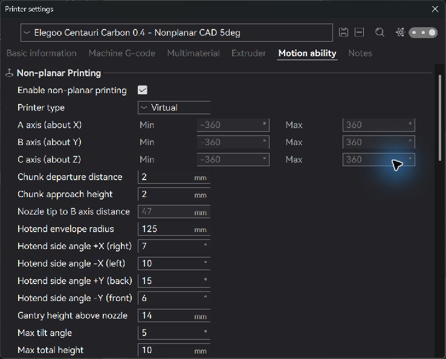
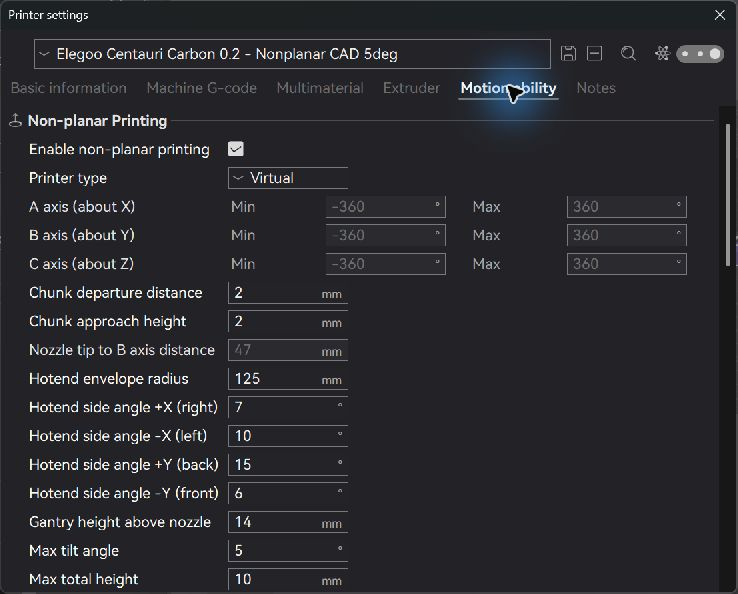
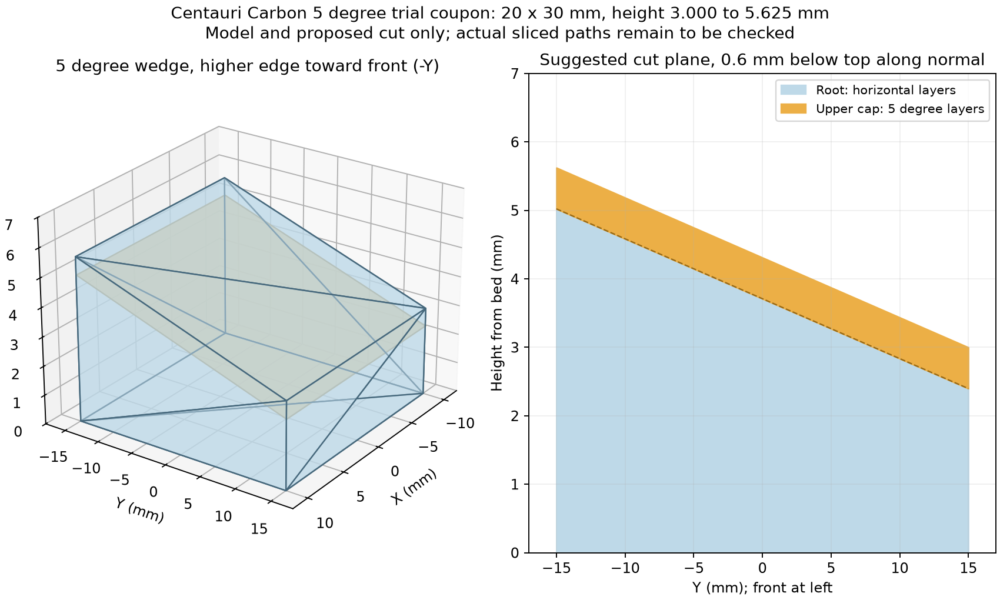

# Centauri Carbon Unlayered experimental presets

**Experimental 5 degree trial settings for an upright-nozzle, three-axis Elegoo Centauri Carbon. Physically unvalidated.** These are CAD-based clearance settings, not a manufacturer-approved configuration or a claim that nonplanar printing is safe on a real machine. The 0.2 mm clearance envelope is conditional on its installed external geometry and nozzle-tip position matching the inspected 0.4 mm assembly.

Created and checked in **Unlayered Slicer 0.1.2** on 10 October 2026. Preset schema version is `2.4.0.7`, as saved by that application. Names refer to nozzle bore diameter; they do not imply a rotating nozzle.

## Preset pairs

| Installed nozzle | Printer preset | Matching process | Ordinary layer height | First layer |
|---|---|---|---:|---:|
| 0.4 mm | Elegoo Centauri Carbon 0.4 - Nonplanar CAD 5deg | 0.20mm Standard @Elegoo CC 0.4 nozzle - Nonplanar Test | 0.20 mm | Stock inherited value |
| 0.2 mm | Elegoo Centauri Carbon 0.2 - Nonplanar CAD 5deg | 0.10mm Standard @Elegoo CC 0.2 nozzle - Nonplanar Test | 0.10 mm | 0.15 mm, stock inherited value |

Both inherit the corresponding installed Elegoo machine and process presets. The 0.2 mm profile has a real 0.2 mm diameter and stock 0.06–0.14 mm layer limits. No filament preset is included; use a material profile already calibrated for the actual nozzle. The 0.4 mm process retains its saved no-brim override; the 0.2 mm process retains stock adhesion settings. Both use **By group** print sequence. No custom speed, temperature, flow or pressure-advance calibration is claimed.

## Actual clearance settings in both printer presets

| Unlayered setting | Value | Source and uncertainty / required verification |
|---|---:|---|
| Enable non-planar printing | ON | Mode selected and read back in UI |
| Printer type | Virtual | Standard XYZ machine; nozzle remains upright |
| Enable belt printing | OFF | Standard bed; explicit false in portable JSON |
| Hotend envelope radius | 125 mm | Spherical cutoff in this version, not horizontal hotend width; measured head radius 123.254 mm and coordinate-expanded radius 123.911 mm. Flexible cable/tube sweep unverified |
| Hotend side angle +X / right | 7 degrees | Conservative rounded CAD enclosure; verify actual duct/shroud position |
| Hotend side angle -X / left | 10 degrees | Conservative rounded CAD enclosure; verify actual duct/shroud position |
| Hotend side angle +Y / back | 15 degrees | Conservative rounded CAD enclosure; verify rear shroud/leads |
| Hotend side angle -Y / front | 6 degrees | Conservative rounded CAD enclosure; verify front duct seating and deformation |
| Gantry height above nozzle | 14 mm | Conservative assembly-clearance proxy below a low fastener at 15.123 mm; actual lower X rod underside 34.250 mm. Wide/tall geometry and travel remain unverified |
| Max tilt angle | 5 degrees | User-requested trial; worst full-mesh normal gap 0.583811 mm. Original conservative recommendation was 4 degrees |
| Max total height | 10 mm | Small-test commissioning ceiling, not established nonplanar machine capacity |
| Chunk departure distance | 2 mm | Trial transition allowance; actual paths must be inspected |
| Chunk approach height | 2 mm | Trial transition allowance; actual paths must be inspected |
| Process print sequence | By group | Unlayered cut-plane/group workflow; verify root before cap in Preview |

The underlying geometry choices use a 0.5 mm nominal allowance. There is **no universal 0.5 mm air-gap setting** entered separately in the preset. This allowance does not bound unknown differences between CAD and the real machine. The reported approximate ±0.05 degree numerical uncertainty also does not bound those physical differences.

The four-side pyramid has a worst-direction limit of **4.565151 degrees**, despite the 5 degree overall cap. The slicer can therefore reject some 5 degree diagonals. Preserve that restriction; inspect a rejected path instead of loosening the envelope to force it through.

## Import

1. Use Unlayered Slicer with the stock Elegoo Centauri Carbon profiles installed, including the nozzle size you actually have. These files depend on those stock presets and were checked against version 0.1.2.
2. Open **File → Import → Import Configs**. Import the matching printer JSON, then the matching process JSON individually. The printer JSON was imported successfully during this task; matching process presets were saved and selected in the UI.
3. Select the imported printer preset and its matching nonplanar process. Confirm the displayed nozzle diameter, Virtual mode, belt OFF, all four angles, radius, height limits, and **By group**. Slicer versions may differ in field semantics or profile availability.
4. Select a previously calibrated material profile. Physically install the matching nozzle; selecting a preset cannot change the hardware.

The portable JSON copies include explicit `type`, nozzle diameter and belt OFF fields in addition to the values read back from the saved user presets. No private application configuration, account metadata or original CAD exports are distributed.

## First test: one 5 degree front-rising wedge

Use [Centauri_5deg_front_wedge_30x20mm.stl](Centauri_5deg_front_wedge_30x20mm.stl), preferably with the already-characterized 0.4 mm nozzle first. Footprint is **20 mm X × 30 mm Y**. Flat bottom; top height **3.000 mm at the back** to **5.624660 mm at the front**. Orient the high edge toward the physical front (-Y), place it near bed center and keep it alone for the first review. The STL is watertight, consistently wound, positive volume 2587.398 mm³.

Importing the STL alone produces ordinary horizontal layers. In Unlayered **Cut Planes**, add one plane parallel to the top, **0.6 mm below it along the plane normal**. Leave the root horizontal and give only the thin cap the inclined build direction. For local X=Y=0 at coupon center, the cut plane is:

`z = 3.710038050 - y*tan(5 degrees)`

Its upward normal leans slightly toward +Y/back; the printed surface rises toward -Y/front. Do not tilt the whole object off the bed. The cap is approximately three 0.20 mm layers or six 0.10 mm layers, subject to the actual generated slice. By group must print the root before the cap.

The full non-contact toolhead mesh has **1.213950 mm normal clearance** to an infinite 5 degree plane rising toward the front, limited by the front cowling/duct at nozzle-relative **(-15.199240, -33.958558, 4.189576) mm**. After subtracting the 0.5 mm allowance, **0.713950 mm** remains. The worst arbitrary diagonal at 5 degrees has only **0.583811 mm** nominal gap, leaving **0.083811 mm** above that target. The front wedge deliberately tests a direction with more modeled clearance.

A hypothetical raised travel at Z=8 mm clears the wedge's highest point by 2.375340 mm vertically. This is a proposal, not a validated slicer transition. Slice and inspect Preview before generating printer code: changing Z during deposition, root-to-cap transition, staging, nearby material, approach, departure, XY traverse and every lift must clear the complete real head/assembly and travel limits. Some transition paths can exceed the 10 mm test ceiling; review them before changing that limit. No actual slice, G-code or printer motion is included or approved by this package.

The original [4 degree coupon](Centauri_clearance_coupon_4deg_30x20mm.stl) and its analysis are also retained in the report as the more conservative starting geometry.

## Physical checks still required

- Compare the actual nozzle-tip height and external tip shape with the inspected 0.4 mm model. Measure the installed 0.2 mm part separately; an official 0.2 mm option does not establish equal outside dimensions or seating.
- Check the lowest duct edges, magnetic shroud seating, silicone sock bulge/fit, heater/block representation, fasteners and loose thermistor/heater/fan wires. CAD hotend names/materials are generic or inconsistent.
- Confirm +X right, +Y back and Z up on the real machine. Check PTFE/cable-chain routing over the intended XY travel, bed obstructions and raised travel behavior.
- Inspect nozzle contact separately. The modeled terminal flat radius is 0.25 mm. At 5 degrees a hypothetical 0.20 mm vertical stand-off above a solid plane gives about 0.177450 mm normal rim clearance; 0.10 mm stand-off gives about 0.077831 mm if the same external flat remains. Fresh extrusion, squish, heat, Z error and actual tip dimensions are not represented by those calculations.

A fixed, flat nozzle tip cannot have a universal 0.5 mm gap at its intended extrusion-contact region. Positive published slope limits describe the non-contact shroud/hotend envelope. Neither a collision-free CAD plane nor a saved preset establishes safe physical printing.

## Benefit compared with normal printing

The main expected benefit on a shallow ramp is fewer horizontal stair steps on the top surface. At 5 degrees, a simple horizontal-layer terrace has approximate pitch `layer height / tan(5 degrees)`: **2.286 mm** for 0.20 mm layers and **1.143 mm** for 0.10 mm layers. An inclined cap aligned with that ramp avoids that particular terrace pattern. These are geometric examples, not measured finish results.

The 0.2 mm nozzle offers finer extrusion/detail and the 0.10 mm profile also reduces ordinary layer stepping; it usually adds paths and print time. A like-for-like comparison should use one nozzle/material and comparable layer spacing, print one planar wedge and one inclined-cap wedge, and compare the top texture. The preset alone does not create angled layers; Cut Planes are still required. This multiplanar workflow approximates surfaces with oriented regions and does not automatically create a continuously curved conformal skin.

Mechanical strength improvement is not established for these settings. It depends on toolpath orientation, material and loading and needs tests. For flat-top objects there may be little finish benefit. The Centauri remains a three-axis printer with an upright nozzle, so these presets do not grant unrestricted overhang, rotary motion or automatic support removal.

## Measurement evidence and sources

Read [MEASUREMENT_REPORT.md](MEASUREMENT_REPORT.md) for the complete component audit, all four cardinal limits, off-axis points, diagonals, finite nozzle-contact caveat, and numerical/physical uncertainty. [MEASUREMENTS.json](MEASUREMENTS.json) preserves reproducible numeric geometry and coupon checks. The provided section figures are **mesh-derived**, not successful native Fusion interference results; those native operations failed.

- [OpenCentauri CAD](https://github.com/OpenCentauri/cad). Observed upstream commit `c63a80d3026bf582296c6372a716c6e80fd5bbae`; the live imported assembly could not be proven to match it. OpenCentauri combines official part CAD and community assembly work.
- [OpenCentauri toolhead documentation](https://docs.opencentauri.cc/hardware/CC1/toolhead/) and [bed documentation](https://docs.opencentauri.cc/hardware/CC1/bed/).
- [Unlayered Slicer v0.1.2](https://github.com/Unlayered3D/Unlayered-Slicer/tree/v0.1.2), including [setting definitions](https://github.com/Unlayered3D/Unlayered-Slicer/blob/v0.1.2/src/libslic3r/PrintConfig.cpp), [collision envelope implementation](https://github.com/Unlayered3D/Unlayered-Slicer/blob/v0.1.2/src/libslic3r/GCode/HotendCollisionCheck.cpp), and its Cut Planes tutorial. The stock inherited Elegoo profiles supply nozzle-specific extrusion/process values.
- [Elegoo assembled Centauri hotend kit](https://us.elegoo.com/products/assembled-extruder-hotend-kit-for-centauri-carbon): official 0.2 mm option; no verified dimensioned installed-clearance drawing was established.

No affiliation or manufacturer endorsement is implied. Files in this package are distributed under [AGPL-3.0](LICENSE.txt), following the upstream slicer license; referenced CAD and other third-party material retain their own terms and are not redistributed. [SHA256SUMS.txt](SHA256SUMS.txt) records the package file hashes.
