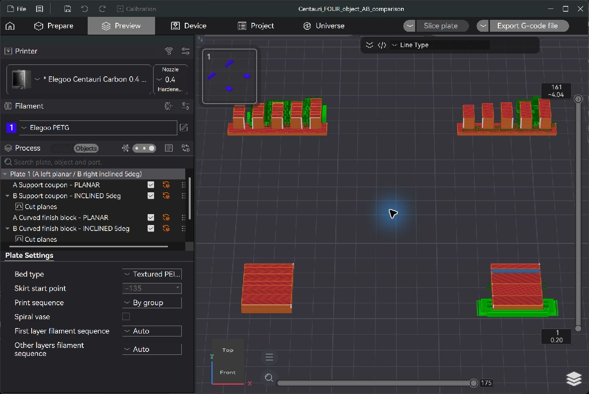

# Centauri Carbon four-part planar / 5 degree comparison

Status on 10 October 2026: CAD models created; four-object project sliced in Unlayered Slicer 0.1.2; native post-slice hotend checker reported **clear**. **No physical print has been performed or reported.** No user G-code file was exported and nothing was sent to the printer.

Open **Centauri_FOUR_object_AB_comparison.3mf as a project**, preserving the objects, cut planes, printer configuration and process overrides. Importing the STL files alone does not create inclined layers. Keep the tested orientation and positions. The project contains exactly four models; the slicer internally creates six sections because each B model has two sections.

| Bed position, viewed from front | Part | Purpose |
|---|---|---|
| Back left | A Support coupon — PLANAR | Horizontal-layer control |
| Back right | B Support coupon — INCLINED 5deg | Same geometry; horizontal root then 5 degree layers |
| Front left | A Curved finish block — PLANAR | Surface-finish control |
| Front right | B Curved finish block — INCLINED 5deg | Same curved geometry; horizontal base then 5 degree layers |

The coupons have five fins with underside angles **55, 60, 62.5, 65 and 70 degrees from vertical**, left to right, equivalently **35, 30, 27.5, 25 and 20 degrees above horizontal**. The increasingly shallow undersides challenge the support rules. This benchmark examines one front-rising 5 degree build direction; it does not test arbitrary diagonals or find the maximum physical printer limit.

The custom curved blocks are 24 mm wide and 30 mm deep. Their fitted-spline surface rises toward the printer front, with a height from about 3.451 to 5.549 mm. The CAD design has slopes about 3.10–4.90 degrees; its actual exported mesh facets have slopes **3.193–4.806 degrees**. Mesh volume is 3307.083 mm³ versus the smooth CAD body's 3308.755 mm³. The small tessellation difference is disclosed; do not treat the STL as an exact analytic curve. The top has a shallow curve around an approximately 4 degree ramp, staying within this experiment's 5 degree ceiling. Its B cap uses a single inclined build direction, so it may retain some terraces on the curved surface; it is not a continuously conformal toolpath.

Both controls share the same 0.4 mm printer, Elegoo PETG material, stock-derived 0.20 mm layer height, temperatures, speeds, walls and infill. Automatic supports are enabled for **both** coupons using Normal(auto), the stock 30 degree threshold above horizontal, stock 50% threshold overlap and stock small-overhang filtering. The ordinary stock process has supports OFF; turning supports ON is a shared experimental change, required to compare generated support. Both share no brim and By group sequence. This job prints groups/sections in turn, not necessarily all four objects at each common Z height.

For B Support, the horizontal section boundary is at original model Z=2.600 mm. For B Curved, it is Z=3.650 mm. Both upper sections use build normal (0, sin5°, cos5°), approximately (0,0.087155743,0.996194698). Plane geometry and build normal are separate settings: the section boundaries are **horizontal**. Earlier trials with inclined section boundaries produced collision warnings at staircase transitions and were rejected. The final flat section boundaries removed those warnings without relaxing the head envelope or tilt ceiling.

| Part | Model deposition estimate | Supports + interfaces estimate | Total moving deposition estimate |
|---|---:|---:|---:|
| A Support, planar | 2.55 g | 0.951 g | 3.50 g |
| B Support, 5 degrees | 2.53 g | 0.349 g | 2.88 g |
| A Curved, planar | 2.22 g | 0 g | 2.22 g |
| B Curved, 5 degrees | 2.68 g | 0.180 g | 2.86 g |

The coupon uses **63.263% less support deposition** in the inclined slice (316.257 mm versus 116.182 mm of 1.75 mm filament), saving about 0.602 g of support at the profile density of 1.25 g/cm³. These are generated-path quantities, not weighed physical results. The mass estimates sum positive E on moving object deposition paths classified as Support or Support interface, combining all internal section IDs. They do not include every priming/retraction compensation or custom start/end extrusion. Full-job slicer estimate is **42m29s**, **4009.10 mm of filament**, **12.05 g**, including its other accounted usage. Per-object acceleration-aware time is not established. The curved B cap adds transition support and more solid-skin material; surface improvement is not free or guaranteed.

The four-part 3MF saves these settings:

| Setting | Value |
|---|---:|
| Printer | Elegoo Centauri Carbon, 0.4 mm |
| Nonplanar mode | ON, Virtual |
| Belt printing | OFF |
| Spherical head envelope cutoff | 125 mm |
| Side angles +X / -X / +Y / -Y | 7 / 10 / 15 / 6 degrees above bed |
| Gantry / low-obstruction proxy | 14 mm above tip |
| Max tilt | 5 degrees |
| Max total explicit G-code Z | 100 mm |
| Departure / approach | 2 / 2 mm |
| Layer spacing | 0.20 mm |
| Sequence | By group |

**Height correction:** the earlier 10 mm Max total height value was incorrect for this job, because the setting checks all explicit G-code moves, including the unchanged stock end move to Z100. It also rejected section travel lifts. The corrected 100 mm limit accommodates those moves; it is not a claim that a 100 mm nonplanar object can be printed. These objects remain below 10 mm; the observed highest deposition is Z9.608, the highest object-tagged move is Z40, and the highest explicit move is Z100. Firmware macros such as homing/cleaning are opaque to this analysis. Printer travel limits and macro behavior still need physical/firmware verification.

Full CAD head XY bounds, relative to nozzle, are approximately X[-37.575,43.118496], Y[-37.8,45.15] mm. Expanding each part's actual deposition bounds, including its actual supports, by this entire head box leaves at least **25.302 mm separation along one axis** from each other part's deposition bounds. This establishes a bounded neighboring-part deposition check. It does not establish continuous clearance along all ordinary travel paths or against printer hardware. The native checker separately samples tip motion and earlier-orientation material; it is a simplified sphere/pyramid check, with finite sampling and same-episode limitations. The initial CAD study's 5 degree front-rising infinite-plane macro gap was about 1.214 mm; the full nozzle terminal contact region is assessed separately.

Before a physical trial, verify the real nozzle seating, shroud/duct/sock positions, lowest screws/wires and +Y/back coordinate direction against the CAD reference. The 0.584 mm value previously discussed is the **worst arbitrary-direction CAD gap at 5 degrees**, not a universal slicer air-gap control and not the finite tip-to-fresh-extrusion gap. A clean Preview is not physical safety evidence.

Print with the installed, characterized 0.4 mm nozzle and the actual calibrated PETG profile; changing material/nozzle/process requires re-slicing and reviewing. Monitor the first inclined section and its approach. Stop on rubbing, dragged material, bent ducts, loss of adhesion or unexpected bed/head motion. Preserve the tested part spacing; changing it can change travel collision risk.

After cooling, photograph all four in their bed positions before removal. Mark their undersides A/B and coupon/curved without changing the test geometry. Photograph the support coupons before support removal. Separate and weigh removed supports with a suitable scale; 0.01 g resolution is useful for these small differences. Compare underside sag/stringing, supported fin count, removal effort and damaged surfaces. Photograph both curved tops under identical low-angle lighting and magnification; compare terrace bands, gouging and bead consistency. Record failures as well as successes.

For GitHub, successful trials support wording such as **“Physically tested on one Centauri Carbon with the stock 0.4 mm nozzle, PETG, Unlayered 0.1.2 and this four-part 5 degree project.”** Add print date, firmware version, actual material/nozzle, photos, measured support masses, observed contact/failures and any changed settings. The 0.2 mm preset remains physically untested and its clearance assumption remains conditional. This test does not establish all-direction 5 degree clearance, every material, full build volume or general nonplanar safety.

Machine-readable slice quantities and saved settings are in comparison_slice_results.json. Original Fusion source files and separate STL exports are retained alongside the 3MF. Project SHA256 for the checked save: 420aa44042b219496b723125cd3060c34ef1894e0501e93d738d39a641053b36. Internal Preview path SHA256: eb3330b12281e7ba8c302bc7a421eb30ba241293e3211340cec225bc3b8e812c.
