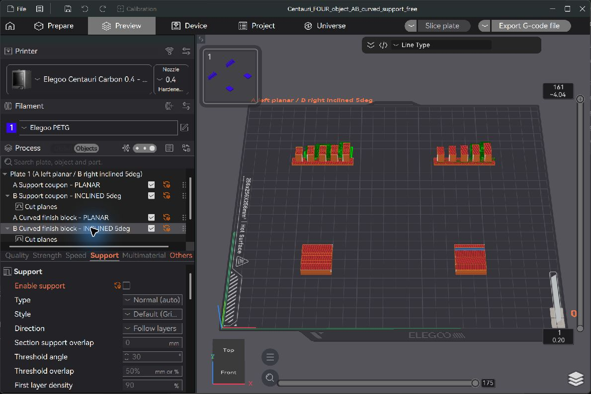

# Four-part comparison with supports removed from the curved block

Status on 10 October 2026: saved in Unlayered Slicer 0.1.2, reopened and re-sliced; native hotend collision check **clear**. **No physical print has been performed or reported.** No user G-code was exported and nothing was sent to a printer.

Open **Centauri_FOUR_object_AB_curved_support_free.3mf as a project**. This is the current variant requested for the curved surface-finish comparison. The original Centauri_FOUR_object_AB_comparison.3mf remains available as a historical baseline with generated transition supports.

The sole effective setting change is the B curved block's object-specific **Enable support = OFF**. Global supports remain ON; the overhang coupons retain exactly the earlier support rules and deposition quantities. The A curved block still generates no supports. No model geometry, placement, cut planes, build angles, machine clearance limits, layer heights, temperatures, or speeds were changed.

| Part | Layer direction | Support deposition estimate |
|---|---|---:|
| A Support coupon, back left | Horizontal | 0.951 g |
| B Support coupon, back right | Horizontal root, then 5 degrees | 0.349 g |
| A Curved block, front left | Horizontal | 0 g |
| B Curved block, front right | Horizontal root, then 5 degrees | 0 g |

The complete job estimate is **42m 2s, 11.87 g**, versus 42m 29s and 12.05 g for the original. Removing the curved block's support saves about 0.180 g and 27 seconds. The coupon's estimated 63.263% support reduction is unchanged. Read-only analysis of internal Preview paths confirms **identical model deposition quantities for all four parts**; only B curved support deposition was removed. These are path and slicer estimates, not weighed results.

## Transition review and its limits

The B curved cut boundary remains horizontal at original model Z = 3.650 mm. Its upper build normal remains (0, sin 5 degrees, cos 5 degrees); the physical nozzle stays upright. The planar root's highest deposition-tip Z is 3.600 mm. The first inclined strip runs from Y = 53.258 to 53.907 mm, at tip Z = 3.771–3.828 mm, entirely within the root's top XY bounds. Thus its tip is about 0.171–0.228 mm above the top root deposition paths. Those are tip-height differences, **not measured underside air gaps**.

Subsequent inclined layers extend toward the back by about 2.295 mm per 0.20 mm layer; the first measured extension is 2.335 mm. There can be local short bridges or overhangs at this advancing transition. A finite sampling comparison with earlier cap lines finds newly extending XY regions whose tip-to-root height difference can reach approximately 0.433 mm. This includes line-spacing effects and is not a bead-shape or adhesion simulation. Turning support off does not establish flawless deposition: sag, poor adhesion, or an imperfect internal transition may occur and must be assessed in a monitored physical test.

A trial aligning the cut boundary itself to 5 degrees was rejected after the native hotend checker reported 43 collision hits. The accepted project retains the horizontal boundary and the original conservative head settings; no clearance limit was loosened. Reopening the saved accepted project and re-slicing again produced **clear**, 102 ms in the installed app log at 14:55:42. The native checker is a simplified finite-sampling envelope check, not complete physical clearance verification.

Full CAD head XY bounds expanded around the actual deposition bounds still give a minimum 25.302 mm separating-axis gap between neighboring objects. This check covers deposition bounds, not every continuous travel path or printer hardware. Real nozzle seating, ducts, sock, screws, wires, travel behavior and firmware macros still require verification described in the main measurement report.

This is an **experimental support-free curved-block slice**, not a physically validated support-free printing method. Keep the 0.4 mm nozzle, characterized PETG profile, part orientation and spacing. Watch the first inclined strip and later advancing edges. Record any sag, rubbing, adhesion failure or other defects, including a failed trial. The 0.2 mm preset remains separately untested.

Project SHA256: c7bc7ef224bbc5d049bd8308d91be6c1e4b6e5facc2a7cd141ad6d63153235bd. Detailed paths and saved settings are recorded in support_free_curve_slice_results.json. No internal G-code files are distributed.
